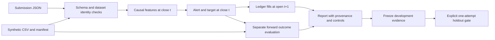

# Architecture: local prototype v0.1

## Design decision

| Approach | Tradeoff | Decision |
| --- | --- | --- |
| Stdlib CLI and bounded declarative JSON | Small, inspectable, offline; limited strategy vocabulary | Selected |
| Dataframe/notebook research stack | Flexible exploration; dependency and hidden-state burden | Out of scope |
| Arbitrary user strategy plugins/service | Extensible execution; needs real process isolation and operations | Out of scope |

The prototype is newly authored here, with no imports from private repositories.
The package runs directly from the checkout. Configuration is data, and strategies
are reviewed built-ins. This keeps the admission surface concrete and bounded.



There is deliberately no arrow from forward outcomes to features or decisions.
The evaluator runs after decisions and the accounting ledger have been produced.

## Components and interfaces

| Module | Responsibility |
| --- | --- |
| `io.py` | Bounded JSON, local paths, canonical hashes, exclusive durable writes |
| `fixtures.py` | Versioned integer generator and expected manifest |
| `data.py` | Byte custody, finite CSV validation, immutable `Bar` records |
| `contract.py` | Strict subset of JSON Schema plus dataset-hash binding |
| `strategy.py` | Pure causal features and fixed liquidity/deleveraging rule |
| `engine.py` | Cash/units accounting, next-open fills, fees, slippage, terminal exit |
| `evaluation.py` | Forward labels, non-overlapping samples, alert diagnostics |
| `research.py` | Provenance reports, freeze, one-attempt holdout orchestration |
| `__main__.py` | CLI parsing, concise JSON summaries, exit codes |

Input limits: 32 KiB JSON, depth 16, 256,000-byte CSVs, at most 1,000 rows, one
parameter set per run, lookback 4–48 bars, horizon 2–24 bars. The contract rejects
additional properties and type confusion (including booleans used as integers).
The schema is machine-readable draft 2020-12 JSON Schema; the stdlib validator
supports only the documented keywords present in it and rejects unknown keywords.
It is not a general-purpose JSON Schema implementation.

## Causal rule

For a lookback L and decision index t >= L:

- Spread ratio = spread[t] / median(spread[t-L:t]).
- Depth ratio = depth[t] / median(depth[t-L:t]).
- Open-interest change = OI[t] / OI[t-L] - 1.

Reference slices exclude t. Every reference observation and current observation
needed for a feature must be present; zero spread medians yield unknown. The rule
counts spread widening, depth depletion, and OI decline against the declared
thresholds. At least `min_signals` flags produce an alert and target cash;
otherwise target long. Warmup or missing features produce an unknown alert and
target cash. OHLCV and liquidation context are retained for custody and evaluation;
they are not secretly used to improve the baseline signal.

Prefix invariance and altered-future tests require that adding or changing future
bars leaves all prior features and decisions unchanged. No fitting or normalization
over an entire dataset is permitted.

## Execution and accounting

Each split starts with the declared initial cash and zero units. Targets are 0 or
1; there is no shorting, leverage, borrowing, fractional target, or intrabar stop.
A target change at close t is executed at **open t+1**. An unchanged target does
not churn the position. A final-row decision has no next bar and cannot execute.
Fill `timestamp` is the next bar's opening time, while `bar_close_timestamp`
identifies its source CSV row. This assumes zero processing latency at the shared
bar boundary; it does not establish executable event/receipt timing in a market.

For fee fraction f and slippage fraction s, an all-cash entry buys:

```
buy_price = next_open * (1 + s)
units = cash / (buy_price * (1 + f))
cash = 0
```

A full exit receives:

```
sell_price = next_open * (1 - s)
cash = units * sell_price * (1 - f)
units = 0
```

Fees apply to executed notional on both sides. Slippage cost is units times the
absolute difference from the reference price. It is already embedded in prices
and must not be subtracted again. The terminal position is liquidated at the last
close using both costs and a distinct `terminal_close` fill with no signal index.
This administrative endpoint is fixed before the run and is not a strategy exit.

Equity is cash plus units times close; the final equity mark includes terminal
costs. Maximum close drawdown uses initial capital and all close marks, retaining
the final pre-exit peak for terminal costs. It does not measure intrabar losses.
Controls are always cash and always long after the same warmup. Both use the same
fees, slippage, and terminal convention. Controls do not filter on market features.

Fixed slippage is an explicit toy assumption, not observed spread plus impact.
Fill probability, partial fills, queues, capacity, financing, funding, and order
rejection are absent. A complete ledger is not evidence that these fills are feasible.

## Outcomes and holdout state

At each anchor t = L, L+H, L+2H, ..., evaluation asks whether a future close in
`t+1..t+H` falls at least the declared fraction below close[t]. It reports first
breach lead bars. These are fixed-anchor adverse-excursion labels, not
peak-to-trough portfolio drawdown or an exhaustive event clustering method.

All H future bars must exist in the split. Unknown alerts and incomplete outcomes
remain in the report but never enter confusion-matrix or precision/recall
denominators. Zero denominators produce JSON `null`. Horizon-stride sampling avoids
overlapping future intervals but does not imply independent observations.

Development reports bind exact config, canonical config hash, source/contract
fingerprint, manifest hash, and exact CSV hash. The source fingerprint includes
all package `.py` files and the contract, not Git metadata or test/docs changes.
Reports omit wall time and host paths so identical inputs produce identical bytes.

Freeze verifies matching development provenance and writes a checksum-bound
receipt. Holdout verifies receipt integrity, unchanged source/config/data identity,
and unchanged development evidence. It exclusively writes and flushes the global
dataset consumption marker before loading holdout. Any later failure preserves
that marker. Concurrent attempts admit at most one writer. These are local
accident-prevention guards; a file owner can forge or remove the evidence.

## Release boundary

The optional developer surface is separate from `market_lab`: static same-origin
browser assets, a disposable loopback mock, and a local stdio-to-HTTPS client.
[DEVELOPER_PORTAL.md](DEVELOPER_PORTAL.md) diagrams the flow;
[PORTAL_CONTRACT.md](PORTAL_CONTRACT.md) records frontend/backend assumptions;
[MCP_ADAPTER.md](MCP_ADAPTER.md) specifies both protocol eras and bounded transport.
No portal or adapter import is required by the offline benchmark. The backend owns
authorization, OAuth, key custody, schema/query enforcement and audit. UI state and
tool discovery convey no entitlement. These components supply no deployment or
database route and never evaluate holdout as part of operation or onboarding.

Tests, code review, statistical evidence, hosting, and financial authority are
different states. Only local engineering acceptance is reachable here. See
[RELEASE_GATES.md](RELEASE_GATES.md) for required evidence and who can authorize
each later transition.
