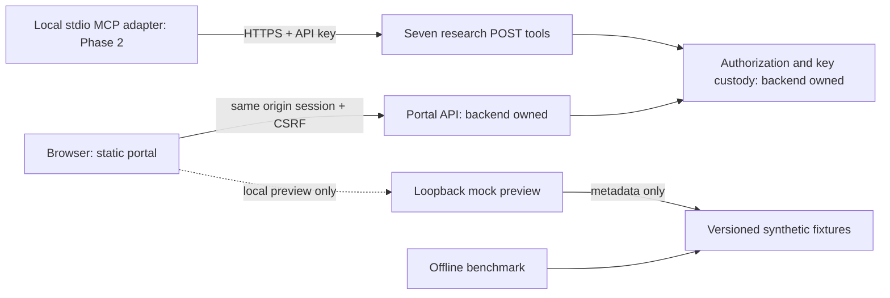

# Synthetic developer portal

Phase 1 is a static responsive UI and a local mock contract demonstration. There
is no public portal deployment, real GitHub authentication, real key issuer,
available real dataset, or certified backend integration in this change.

## Run and review

From the checkout root, run `python3 -m developer_portal.demo` and visit
`http://127.0.0.1:8765/portal/`. The CLI accepts `--port 0` to choose a free port;
it never accepts a bind address. Ctrl-C stops it and discards all mock state.
No package install, database, account, secret, or external request is needed.
The banner and scenario selector are visible only when session mode is `demo`.
Use the selector to review every access state, delayed catalog, and API failure.
The GitHub link leads to an explicit mock notice; it never contacts GitHub.

```bash
python3 -m unittest discover -s tests -v
node --test developer_portal/tests/state.test.mjs
python3 -m market_lab verify-data
python3 -m market_lab validate submissions/baseline.json
```

Optional rendered checks: with an existing trusted Playwright installation and
browser, run `node developer_portal/tests/browser.cjs`. `PLAYWRIGHT_MODULE` and
`PLAYWRIGHT_CHROMIUM_EXECUTABLE` can select local installations; do not commit
machine paths. The script starts its own ephemeral loopback fixture, blocks page
requests to other origins, runs nine desktop/mobile checks and stops both processes.
Screenshots contain only the synthetic landing page and live under ignored
`artifacts/browser/`. Never capture or retain a real once-only key in screenshots,
traces, logs, tests, or issue reports. Browser checks are not installed in PR CI;
CI runs the dependency-free Python and Node checks on GitHub-hosted runners.

## Reuse and contract

Mount the four files in `developer_portal/static/` at `/portal/`, preserving their
relative paths and module MIME types. No bundler, CDN, remote fonts, analytics,
service worker, or persistent browser storage is used. Render API content with
text nodes. Backend mutations always require `X-CSRF-Token`; the session owns
the token. Never use the fixture's scenario handler or identity in production.

[PORTAL_CONTRACT.md](PORTAL_CONTRACT.md) distinguishes agreed routes from proposed
nested envelopes. Those proposals need backend agreement: access status vocabulary,
access-request payload, once-only secret response, catalog metadata, quota shape,
and error/expiry behavior. No real key or session was used to test these assumptions.
The backend must authenticate and authorize every operation even if controls are
hidden. Logout must invalidate the session; rotation must invalidate its predecessor
atomically; revoked/expired keys must fail through all REST and MCP entry points.



## Dataset and contribution evidence

The catalog is `synthetic-liquidity-v1`, asset `TOY-USD` (invented), venue `NONE`.
The authoritative identifier is read from the [manifest](../data/synthetic-v1/manifest.json).
See [DATA_POLICY.md](../DATA_POLICY.md) for exact split timestamps/hashes and
all field meanings. The portal includes OHLC, volume, spread, depth, open interest,
and liquidation context with typed units; empty optional observations remain unknown.
Hourly coverage has a 24-hour split gap and two intentionally missing depth entries
per split. Freshness means frozen fixture, not live ingestion; v1 source files are
retained immutably. Original fixture source and license are displayed, with no
redistribution claim about external market data.

Use a bounded manifest in `submissions/`, validate it against the pinned dataset,
retain every development attempt, then submit a focused PR with source and data
identities, costs, causal timing, commands, results, and limitations. The challenge
asks for reproducibility and code critique about liquidity deterioration before
drawdowns, not strategies/alpha. No public claim follows from synthetic results.
Do not evaluate holdout as part of UI review or CI. Freeze selection before a
separately authorized attempt; a visible toy holdout is not blind market evidence.

## Operations and rollback boundary

Local operation is a single disposable process. Stop it to revoke all mock state.
Rollback UI changes by selecting a reviewed earlier source commit in a separate
review branch; do not reset shared worktrees or force-push. A future backend mount
must set CSP (self-only scripts/styles/connect, no framing), secure HttpOnly
SameSite cookies, TLS, MIME types, and no-store for session/key/API responses.
Static UI rollback must never restore a revoked key or reset quotas. Backend
ledger backup/restore and OAuth incident response belong to its own reviewed runbook.

Phase 1 local evidence is in [PORTAL_VALIDATION.md](PORTAL_VALIDATION.md). Phase 2
adds the outbound HTTPS stdio adapter; backend integration and activation are later,
separate gates. A real-data release requires source acquisition and redistribution
rights, reviewed field/schema/availability semantics, immutable snapshot identity,
dedicated authorization and quota tests, operational ownership, and Patrick's
approval of the exact data/version/release. No production connectivity is admitted
by this document. Cost research is supplied separately and is not measured capacity.
