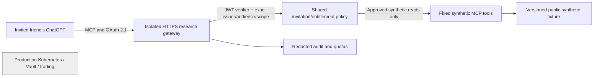

# Open Research Commons — private ChatGPT connector pilot

**Status:** Implementation preparation only — not a deployed, authenticated, or publicly reachable service.  
**Date:** 2026-10-23  
**Branch:** `feat/private-connector-pilot-20261023` (stacked on PR #7)  
**Target users:** Owner and one explicitly invited friend  
**Source authority:** `AGENTS.md`, `SECURITY.md`, `DATA_POLICY.md`, and `docs/RELEASE_GATES.md` remain authoritative. The ORC product specification is non-authoritative.

## User story and non-goals

An invited friend should be able to use **their own supported ChatGPT account** to connect to the Open Research Commons research service, authenticate as a *distinct research-service user*, discover exactly one public synthetic dataset, describe its provenance, and request a bounded sample. A non-invited person and another authorized person must not obtain that account's permissions.

The user is identified by a verified **identity-provider issuer + subject** pair. ChatGPT login status, ChatGPT display names, GitHub handles or emails, network origin, and a caller-selected `user_id` are **not** server authorization evidence. ChatGPT is an OAuth client, not our account database.

**Out of scope for this pilot:** real or licensed external market data, Kubernetes/Vault/Proxmox/ClickHouse access, arbitrary queries/SQL, external code execution, strategy submissions, payments, agent-to-agent transfers, live trades, public app-directory publication, and bringing external users into the production cluster.

## Current implementation inventory, independently inspected in repository

| Component | Observed | Current limitation |
| --- | --- | --- |
| PR #7 `integrations/synthetic-mcp/server.mjs` | Three fixed, read-only tools; loopback `127.0.0.1` bind, Host/Origin checks, request-size/deadline guards | No OAuth, user identity, entitlements, metering, cross-user audit or public HTTPS profile |
| PR #7 `catalog.mjs` | Fixed synthetic development CSV, SHA-256 check, at most 20 rows, no dynamic filesystem/tool URLs | Synthetic benchmark only; no real licensed data |
| PR #7 test suite | Official-client MCP invocation and negative argument/network tests | Does not prove external hostile-code isolation, OAuth, TLS termination or production readiness |
| Existing `developer_portal` | Local demo of access, keys, and usage states | Mock OAuth and fake keys, **not** an authentication service |
| Existing `omr_mcp` | Local stdio client sending an API key to a separately approved HTTPS research API | Distinct transport, **not** a per-user ChatGPT OAuth issuer |
| New `pilot-access-policy.mjs` | Pure deny-by-default policy decision for verified claims, server-side invitations and synthetic entitlements | **Not connected to server** and **does not authenticate, verify JWT signatures, or enable access** |

The code findings above are a bounded source review. They are **not** an independent penetration test, Kubernetes/Vault security assessment, or deployment approval.

## Proposed architecture

**No network path from the gateway or MCP process to production Kubernetes, Vault, workstations, or trading.** The synthetic-only pilot should run on a separate reviewed account/project/network (or an owner-controlled local process through an explicitly approved secure tunnel for development) and not as another namespace in the trading cluster.

## Authentication contract to implement **after** issuer approval

1. Choose a **mature OAuth/OIDC identity provider** with an isolated development tenant. GitHub may be an *upstream sign-in method*, but do not treat a raw GitHub OAuth token as a resource-specific MCP token. The provider or trusted authorization server must mint access tokens for the research resource.
2. Publish `/.well-known/oauth-protected-resource` and authorization-server discovery with exact issuer. When missing credentials, return `401` with a correct `WWW-Authenticate: Bearer resource_metadata="..." ` challenge. Advertise per-tool `securitySchemes`; no anonymous fallback for account-linked data.
3. Support authorization code + **PKCE S256**, `state`, correctly registered redirect URIs, issuer identification (`iss` where supported), and resource binding through OAuth's `resource` parameter. Prefer Client ID Metadata Documents (CIMD) if the chosen provider supports them; fall back to a reviewed supported registration mode. Do not pre-register an unverified redirect URL.
4. The HTTPS MCP resource server independently verifies token signature against provider JWKS, pinned algorithms, exact `iss`, expected `aud`/resource, `exp`, `nbf`, `research:read` scope, and applicable client/authorized-party constraints **for every protected request**. Never trust decoded-but-unverified JWT JSON.
5. Resolve provider `(issuer, subject)` to one immutable internal user ID. **Separately** confirm that a signed-in user is on the invitation allowlist, approved, not revoked, and entitled to the requested **synthetic** dataset. A valid login alone never grants access.
6. Perform policy, global/per-user quotas, and audit centrally for REST and MCP; fail closed when identity, entitlement, revocation state or the ledger is unavailable. Do not rely on browser UI, model instructions, tool annotations, forwarded headers, or client-supplied roles to enforce any permission.
7. Tokens must be short-lived; plan refresh-token rotation/revocation if the provider issues refresh tokens. Access, refresh tokens, issuer secrets, cookies and authorization codes must never appear in source, prompts, URLs, CI output, request logs, browser storage, or screenshots.
8. For a later internet-facing service, add TLS, body/concurrency/time limits, ingress-level DoS defense, allowlisted outbound destinations, no cloud metadata access, verified proxy Host/Origin configuration, vulnerability handling and a revoke-all stop switch. A loopback Host validator cannot simply be repurposed as a public auth gateway.

For provider/ChatGPT compatibility, verify the current guidance rather than relying on these design notes:
- https://developers.openai.com/plugins/build/auth
- https://help.openai.com/en/articles/12584461-connecting-custom-mcp-servers-in-chatgpt
- https://modelcontextprotocol.io/specification

## Permission matrix (pilot)

| Principal | `list_datasets` | `describe_dataset` | `get_sample` | Anything else |
| --- | --- | --- | --- | --- |
| No or invalid token | Deny | Deny | Deny | Deny |
| Valid token, not invited | Deny | Deny | Deny | Deny |
| Invited, pending/disabled/revoked | Deny | Deny | Deny | Deny |
| Invited and approved, correct resource and `research:read` | Synthetic catalog only | Synthetic fixture only | At most 20 synthetic development rows | Deny |
| Owner/operator | Same research permissions for this endpoint | Same | Same | **No privileged tools on this endpoint** |

**Trust boundary:** `pilot-access-policy.mjs` evaluates a *trusted* verified-claims object and a *trusted* account record. It is a pure unit-tested decision function, not a verifier. It must not be wired to `/mcp` until an independent issuer/JWKS verification layer and integration tests exist. The current unauthenticated local prototype must never be presented as an authenticated friend connector.

## Required acceptance tests and evidence

- **OAuth protocol:** metadata discovery, valid PKCE S256 round trip, correct redirect allowlist, issuer mix-up protection, token exchange resource binding, refresh-token handling if enabled.
- **JWT and request:** anonymous, forged-signature, unsigned, unknown-key, wrong algorithm, wrong issuer, wrong resource/audience, expired, premature, missing scope, reused/rotated or revoked credentials all denied. Validate a token from ChatGPT through the provider and inspect only redacted claims/audit.
- **Account isolation:** two test user identities, one invited and one not; mismatch `sub`/issuer, renamed GitHub handle, modified email, forged `user_id`, revoked and pending invite, and cross-user token attempts denied. Disconnect/revoke within a measured bounded interval.
- **Tool and data bounds:** only the three fixed tool names; no SQL, URL/SSH, shell, Kubernetes, Vault, real-market or trading tools; exact synthetic dataset/provenance/rows; no hidden holdout reads through MCP.
- **Network isolation:** independent tests from the actual planned hosting environment show default-deny egress to workstation/cluster API/Vault/Proxmox/production DB, blocked RFC1918/link-local/metadata targets, and absence of production kubeconfigs/service-account tokens in process/container. *Do not obtain production secrets merely to test absence.*
- **Operations:** 401/403/429 behaviors; redacted audit for allow/deny and rows; bounded rate/response/body/concurrency/CPU/memory; alerts and emergency admission stop; restore does not revive revoked accounts.
- **Human acceptance:** one invited friend can connect through ChatGPT **web** on an eligible plan and retrieve synthetic data; the friend can disconnect; owner can revoke, then verify denial. If the friend's plan cannot connect, test through the portal rather than weakening authentication.

## Ordered implementation gates

| Gate | Deliverable | Exit condition |
| --- | --- | --- |
| G0 — PR #7 | Independent code review, dependency/CI review, separate cluster/Vault boundary evidence | Explicit owner approval before merge/deployment; this branch does **not** satisfy G0 |
| G1 — Local policy contract | `pilot-access-policy.mjs` and negative unit tests | Targeted Node tests pass and existing synthetic tests remain green |
| G2 — Development IdP | Named provider/tenant, OAuth metadata and app registration in secure config (not Git) | End-to-end OAuth tests pass for two identities; no static-key fallback |
| G3 — Isolated network and gateway | Reviewed dev HTTPS service or controlled secure MCP tunnel; no production routes | Firewall/effective egress/401/resource tests and rollback verified |
| G4 — One-person private pilot | Owner-issued invitation and owner-approved tester onboarding | Friend uses three synthetic-only read tools; revocation verified |
| G5 — Future business pilot | Licensed dataset qualification and separately priced access, if justified | Separate design, contractual rights, billing and security approval |

No gate automatically advances another. A passing CI job or merged documentation PR is **not** deployment authority. No user invitation, spend, host/network mutation, hosted authentication, production credential retrieval, cluster permission, or live-data admission was approved by creating this design.

## Suggested next PR breakdown

1. **Security review of PR #7:** verify reviewed source, dependency lock, CI event/token permissions, local Host/Origin logic, data provenance, no secret/network access, and required independent cluster/Vault assessment. Record blockers without auto-merging.
2. **OAuth resource-server integration:** wire the externally verified principal and account lookup through the policy evaluator; add `401` metadata and per-tool `securitySchemes` and no-bypass negative integration tests, in a separate reviewed PR.
3. **Deployment/runbook PR:** only after explicit approval, add isolated environment definition, no-prod-network policy, TLS/ingress quotas, observability, stop switch and restore/revoke tests.
4. **Friend onboarding:** single invite, only synthetic data, documented disconnect and revocation.

**Do not invent or assume a friend's ChatGPT account identity. The owner must choose and invite a verified identity through the research service.**
