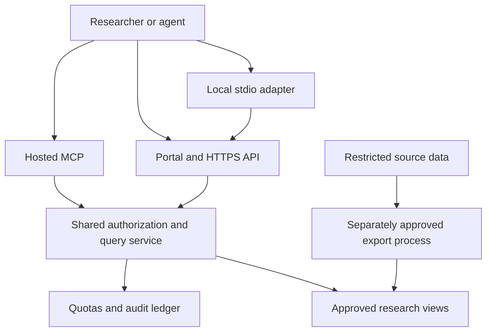

# Protected real-data service design — inactive

Phase 4 is design only. Synthetic fixtures are the only approved implementation input. This document grants no deployment, network connection, credentials, data access or dataset publication.

## Separation and data flow

Prefer an approved, versioned export into a separate research data plane. The public API should not query the trading cluster. A dedicated read-only service identity accesses only reviewed product views in the research plane; end users receive scoped API credentials, never database credentials.

There is no route from the portal, local adapter or external research code to a Kubernetes API, Vault endpoint, production database or trading executor. The diagram names logical components only. It is not a disclosure of physical schemas or a claim that any real-data service exists.

## One policy authority

REST, hosted MCP and account actions share backend policy and the same durable identity ledger. The website displays policy outcomes; adapters never decide whether data is licensed or a user is entitled.

An admitted query must satisfy all of: approved account, active unexpired credential, correct issuer/audience when OAuth is used, required scope, dataset entitlement, reviewed dataset license manifest, supported schema version, bounded time interval/rows/bytes/concurrency and remaining account quota. Refusal is fail-closed. Metadata endpoints apply the same disclosure policy as data endpoints; unknown and unauthorized private dataset identifiers must not reveal inventories.

Dataset manifests contain public logical field names, units, asset/venue identifiers, event/observation semantics, schema version, coverage dates, grain, freshness, explicit gaps, retention, provenance and license status. Physical database names, private addresses, source credentials and internal inventories are excluded.

## Future infrastructure choices

1. **Initial synthetic beta:** separate VPS, no research database or source connectivity, fixed fixtures.
2. **Real-data pilot:** separate research database/replica or immutable object snapshots, filled by a separately approved exporter. Restrict field, asset and time coverage before transfer.
3. **Larger service:** a separate Kubernetes cluster/account/network if justified by measured workload. A new namespace in the trading cluster is not equivalent isolation.

The research application identity has SELECT only on exact reviewed product views. It has no grants on system inventories, source tables, users, administrative operations, arbitrary table functions or outbound database fetches. Enforce database-side row/time/read-byte/memory limits as a second boundary; requests remain typed and parameterized in application code. No customer-supplied SQL fragments or identifiers.

The public runtime has no Kubernetes service-account token, node mount, Docker socket, host PID/network namespace, cloud instance privileges or route to private management networks. If future Vault integration is approved, a dedicated server workload identity may retrieve only its own short-lived data-service credential; users and local adapters never receive that identity. Prefer no direct Vault route from the public-facing tier.

Network rules default-deny inbound and outbound access, admit only the required HTTPS and research-service paths, and block management/control planes and cloud metadata endpoints. GitHub OAuth uses fixed validated HTTPS destinations with no token-bearing redirects. Avoid broad network peering as a shortcut.

## Required approvals and evidence

| Gate | Evidence needed before activation |
| --- | --- |
| License and redistribution | Dataset/version-specific source permission and terms; allowed fields, transformations, users, geography, retention, revocation and downstream redistribution rules |
| Data qualification | Coverage/gaps, timestamps and availability semantics, deduplication, revisions, null meanings, reproducible snapshots and schema contract |
| Identity and authorization | Dedicated service identity; reviewed exact grants; cross-tenant negative tests; credential expiry/rotation/revocation; OAuth issuer/audience/PKCE/consent evidence |
| Kubernetes and network | Approved separate environment; no production namespace shortcut; validated deny rules and no public management APIs |
| Secret custody | Approved workload-specific credential route, rotation, log redaction, backup encryption and recovery drill |
| Capacity and abuse | Measured query cost; account and global limits; bounded audit storage; ingress limits and tested exhaustion/recovery |
| Public operations | TLS/domain, security intake, owners, response process, dependency review, monitoring, incident stop and rollback rehearsal |
| Final activation | Patrick approves the exact release commit, dataset manifest, environment, connectivity and credentials |

Existing repository runbooks are design context only. No live cluster or Vault posture was inspected or certified for this mission. A previous readiness document cannot substitute for fresh pre-deployment evidence.

## Research execution boundary

Keep external executable strategy code in restricted GitHub-hosted CI or separately isolated ephemeral runners. Never run it in the API container, research database host or production trading cluster. Runners have no production secrets, OIDC credentials, private network route or persistent shared workspace. Pin actions and dependencies, bound CPU/memory/disk/time/egress, and treat artifacts as untrusted input. The current public benchmark accepts bounded declarative manifests and reviewed built-in implementations.

A richer experiment manifest should bind dataset and schema hashes, source commit, dependency lock/container digest, seed, declared split, search history, costs, controls, query limits and expected output hashes. Preserve failed attempts. Publication of a result never proves market profitability or authorizes trading.

The existing strategy experiment runtime offers useful deterministic manifests and retained evidence patterns; its documented trusted-code process containment is not a hostile-code sandbox. Do not expose its execution or strategy tools through this data MCP.

## Operation and rollback design

Before activation, back up the authorization ledger consistently and perform a restore drill. Monitor request count and response bytes, quota refusals, auth failures, latency, queue time, database contention, audit retention and storage growth. Never log bearer tokens, OAuth codes, cookies, plaintext keys, request bodies or raw restricted data.

For a suspected access failure: stop admission, revoke affected account/credential families, preserve redacted audit evidence, then remove public routing if necessary. Revocation must apply across REST/MCP and all replicas. Roll back code using a pinned reviewed artifact; do not automatically roll back the access ledger.

A stale backup can resurrect revoked keys and OAuth tokens. Restore into a disconnected environment, invalidate all restored sessions/tokens/keys or reconcile a separately preserved monotonic revocation record, and require re-authentication/reissuance before reconnecting. Preserve usage enforcement and incident evidence; never reset quotas as a rollback convenience. Validate schema compatibility before changing the application version. Restarting a service is not evidence that authorization is correct.

No deployment manifest here points at an existing infrastructure repository's automatically synchronized paths. Implementation and activation will be separate reviewed work after the gates above.
